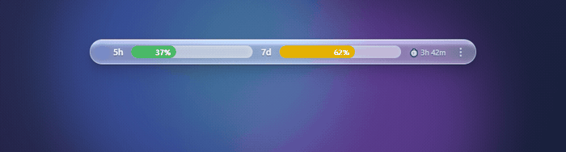

<div align="center">

# Claude Usage Limits Bar

**Know how much Claude you have left, without leaving what you're doing.**

A small always-on-top glass bar showing your 5-hour and 7-day usage limits —
and what Claude Code is doing right now.

Windows · macOS · Linux · MIT



**[Try the live bar →](https://noamelyasim.github.io/Claude-usage-limits-bar/)** — the real shader, running in your browser

[Download](../../releases/latest) · [Install](#install) · [Using it](#using-it) · [How it works](#how-it-works) · [Full setup guide](INSTALL.md)

</div>

---

## Why

- **Your real limits, not a guess.** Numbers come straight from the same
  claude.ai usage API the web app uses, polled every 30 seconds.
- **See trouble coming.** Bars stage from green to yellow to orange to red, so
  you notice you're near a limit before you hit it, not after.
- **Know when it resets.** Hover the bar and it lifts to show the exact reset
  time for both windows. The countdown to the next 5-hour reset is always on.
- **Watch Claude Code work.** A status dot follows your sessions live — blue
  while working, blinking yellow when it needs you, green when the turn is
  done, grey when nothing is running.
- **Actually made of glass.** The bar captures the desktop behind it and runs
  it through a WebGL shader: bevelled rim, chromatic aberration, frosted
  interior, bloom. `backdrop-filter` cannot do this in a transparent window —
  it only samples the page itself — so this samples a live `desktopCapturer`
  feed instead, excluding itself so there's no feedback loop.
- **Multi-monitor and mixed-DPI aware.** Drag it to another screen and it
  re-acquires that display's capture at that display's scale factor.
- **Nothing to configure.** No API key, no config file to edit, no org id to
  paste. Sign in once through the app's own window; everything else is
  discovered.
- **Stays out of the way.** No dock icon, no taskbar button, no window chrome —
  just the bar, on top of everything, wherever you put it.

## Install

**[Download for your system →](../../releases/latest)** then follow the one line
for it. No Node, no clone, no build.

<details open>
<summary><b>Windows</b></summary>

Download `…Setup….exe` and run it.

The build is unsigned, so SmartScreen shows a blue box on first launch:
**More info → Run anyway**. Prefer nothing installed? Take the
`Claude Usage Limits Bar ….exe` without *Setup* in the name — it is portable
and runs as-is.
</details>

<details>
<summary><b>macOS</b></summary>

Paste this into **Terminal** and press Return:

```bash
curl -fsSL https://raw.githubusercontent.com/NoamElyasim/Claude-usage-limits-bar/master/install.sh | bash
```

It picks the right build for your Mac (Apple Silicon or Intel), puts the app in
Applications and starts it. Run the same line again to update.

Then allow **Screen Recording** when macOS asks — the glass effect reads the
desktop behind the bar. Without it you get a plain dark pill and everything else
still works. After an update macOS may ask again.

<details>
<summary>Prefer the .dmg?</summary>

| Your Mac | File |
| --- | --- |
| Apple Silicon (M1 and later) | `…-arm64.dmg` |
| Intel | `….dmg` — the one without `arm64` |

Open it and drag the app to Applications. The build is not notarized by Apple,
so the first launch is blocked: open **System Settings → Privacy & Security**,
scroll down and click **Open Anyway**. Or clear the download flag once:

```bash
xattr -dr com.apple.quarantine "/Applications/Claude Usage Limits Bar.app"
```
</details>
</details>

<details>
<summary><b>Linux</b></summary>

Download the `.AppImage`, then:

```bash
chmod +x 'Claude Usage Limits Bar-'*.AppImage
./'Claude Usage Limits Bar-'*.AppImage
```

No install step — an AppImage is the application. Live capture needs a
compositor that allows `desktopCapturer`: fine on X11, portal-dependent on
Wayland.
</details>

Then **sign in** in the window that opens, using an **email code** — Google
sign-in refuses an embedded browser. Once per machine; the session lives in the
OS user-data dir. That's the whole setup.

### Optional: the status dot

The usage bars work on their own. The dot only lights up once Claude Code can
tell the bar what it is doing, which takes a hook:

```bash
git clone https://github.com/NoamElyasim/Claude-usage-limits-bar
cd Claude-usage-limits-bar
node scripts/install-hooks.js
```

Run it **where Claude Code itself runs** — a normal shell on macOS and Linux, or
*inside WSL* on Windows if that is where you use Claude Code. No `npm install`
needed. Undo with `--uninstall`.

### Running from source

```bash
git clone https://github.com/NoamElyasim/Claude-usage-limits-bar
cd Claude-usage-limits-bar
npm install
npm start
```

Needs Node 18+. See [INSTALL.md](INSTALL.md) for building installers, where your
data lives, and troubleshooting.

## Using it

| Action | What happens |
| --- | --- |
| **Drag** the bar | Moves it. The position is remembered. |
| **Hover** the bar | Lifts it and reveals the exact reset time for both windows. |
| **Click the ⋮ button** | Opens the menu: Refresh now · Always on top · Start at login · Reset position · Shape · Sign in / Sign out · Quit. |
| **⋮ → Shape** | Bar, Capsule, Square or Circle, for tight screens. The widget morphs into the new shape; the choice is remembered. |
| **⋮ → Rotate 90°** | Capsule only: stands it on end, or lays it back down. Its contents glide into place. |

Every shape keeps the glass, the status dot, the countdown and the colour
stages. The capsule shows each window as a small ring; the square and circle
trace them as two outlines along their edge (outer 5h, inner 7d). Hovering a
compact shape swaps the readout for the two reset times. Outside the widget the
window is click-through, so its shadow margin never swallows a click.

The menu sits behind a button rather than a right-click because the bar is a
drag surface — Windows hit-tests that as the window caption and answers a
right-click with its own Move/Size/Close menu before the app ever sees it.

## What the bar tells you

| Element | Meaning |
| --- | --- |
| `5h` bar | The 5-hour window, as a percentage of the limit |
| `7d` bar | The 7-day window |
| Bar colour | Green under 50% · yellow 50–80% · orange 80–90% · red 90%+ |
| `⏱` | Time left until the 5-hour window resets |
| Dot, blue | A Claude Code session is working |
| Dot, yellow blinking | A session needs your input |
| Dot, green | The turn finished |
| Dot, grey | Nothing is running |
| `—` in place of a number | The usage request failed: expired session or no network. It retries every 30s |
| `⚠ sign in` | No claude.ai session — open the menu → *Sign in to Claude…* |

## How it works

| File | Role |
| --- | --- |
| `main.js` | Window, polling loops, menu, screen-capture IPC |
| `index.html` | The bar itself: layout, usage/status rendering, the glass shader |
| `preload.js` | The only bridge between the two (context isolation is on) |
| `src/auth.js` | claude.ai sign-in window + persistent cookie jar |
| `src/usage.js` | Usage API, org-id discovery |
| `src/status.js` | Finds and reads the Claude Code status files |
| `src/config.js` | Per-machine settings in the OS user-data dir |
| `hooks/claude-status.sh` | The Claude Code hook that writes those status files |
| `scripts/install-hooks.js` | Installs that hook and wires it into `settings.json` |

Nothing machine-specific lives in the source: the account is a cookie jar in
the user-data dir, the org id is discovered on first run, and the status
directory is probed. That is what makes it portable.

### Status dot mechanics

The hook writes `/tmp/claude-status/<session-id>` containing `working`, `input`
or `done` on each Claude Code lifecycle event, and deletes it at session end.
The overlay polls that directory once a second and shows the most urgent state
across all live sessions.

Two details that are easy to get wrong, both handled:

- `Notification` fires both for real permission prompts *and* for the idle
  "Claude is waiting for your input" nudge. After `Stop` has run, nothing is
  executing, so that nudge is suppressed instead of turning a finished task
  yellow.
- Background-job sessions never appear in `pgrep -af session-id` — their id
  only exists in the hook payload, never in a process command line. Liveness
  therefore falls back to file recency (15 min), or those sessions would show
  as grey.

On Windows the overlay runs natively. If Claude Code runs inside WSL — the
usual setup — it reads those files over `\\wsl.localhost\<distro>\tmp\...`,
probing every installed distro; when Claude Code runs natively too, it finds
them in `%TEMP%\claude-status`.

### Development

```bash
npm start          # run from source
npm run hovertest  # hover hit-test regression check
npm run glasslab   # shader tuning harness
```

The bar calls `setContentProtection(true)` so the shader does not capture
itself, which also makes it invisible to every screenshot tool. `hovertest`
exists because of that: the hover behaviour cannot be eyeballed on the live
bar, so it is asserted against a scripted cursor instead.

## Legacy

`overlay.py` and `SETUP.md` are the original tkinter version, Windows-only and
superseded by this app. They are kept only for reference.

## License

MIT — see [LICENSE](LICENSE).
